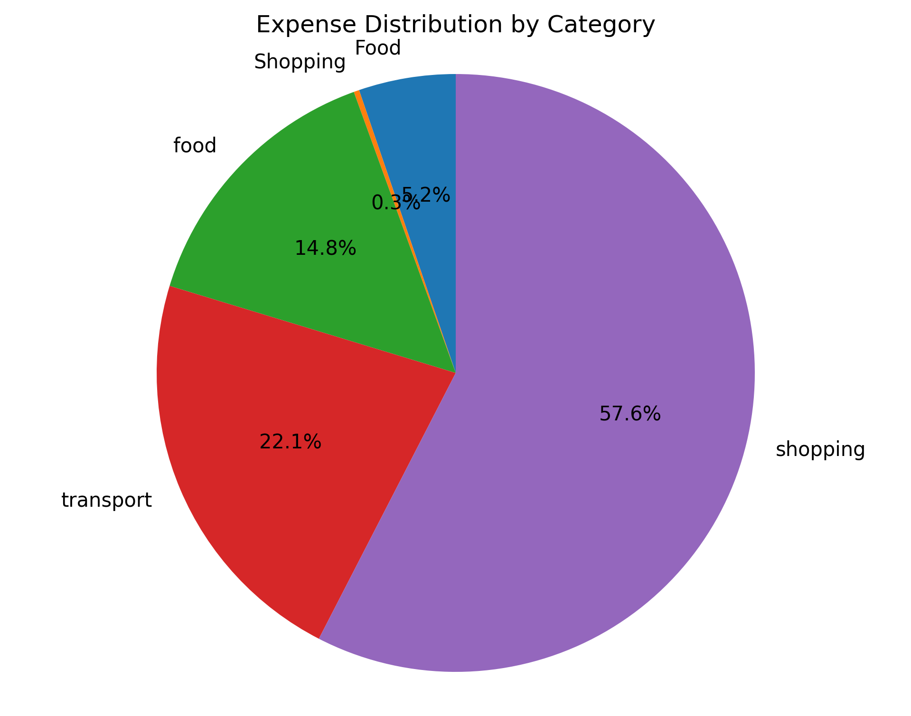

# Expense Tracker — 支出記帳系統

## 1. 專案介紹
本專案使用 Python 開發一套簡易支出記帳系統，讓使用者可以輸入日常支出資料，並將資料儲存至 CSV 檔案中。
系統也提供視覺化功能，能夠讀取已儲存的支出資料，依照不同支出類別統計金額，產生圓餅圖，方便使用者直觀了解各類別的支出比例。

## 2. 專案功能

### Input Module
- 提供使用者輸入支出資料的功能。
- 輸入Date、Amount及Category。
- Notes為選填項目。
- 檢查日期格式是否正確。
- 檢查金額是否為有效數字並且大於0。
- 將支出資料儲存至 "expenses.csv"。
- 支援新增多筆支出資料。

### Visualization Module
- 讀取 "expenses.csv" 中的支出資料。
- 統計各個類別的支出總金額。
- 使用 Matplotlib 產生圓餅圖。
- 在圓餅圖中顯示各類別所占比例。
- 將圓餅圖儲存為 PNG 圖片。

## 3. 專案架構

```text
ExpenseTracker/
│
├── input.py              # 支出資料輸入模組
├── visualization.py      # 支出資料視覺化模組
├── expenses.csv          # 支出資料儲存檔案
├── requirements.txt      # Python 套件需求
├── screenshots/          # 圓餅圖輸出資料夾
│   └── pie_chart.png
│
└── README.md             # 專案說明文件
```

## 4. 環境需求

- Python
- Matplotlib

安裝所需套件：

```bash
pip install -r requirements.txt
```

或直接安裝 Matplotlib：

```bash
pip install matplotlib
```

## 5. 使用方式

開啟終端機，進入專案所在資料夾：

```bash
cd ExpenseTracker
```

### Step 1：執行輸入模組

執行以下指令：

```bash
python input.py
```

執行後會出現以下選單：

```text
===== Expense Tracker =====
1. Add Expense
2. Exit
Choose an option:
```

選擇 "1" 即可新增支出資料。

依照畫面提示輸入：

- Date：日期，格式為 YYYY-MM-DD
- Amount：支出金額，必須大於 0
- Category：支出類別
- Notes：備註，可留空

輸入完成後，系統會將資料新增至 "expenses.csv"。

選擇 "2" 即可結束程式。

### Step 2：執行視覺化模組

確認 "expenses.csv" 已經有支出資料後，執行：

```bash
python visualization.py
```

系統會讀取 CSV 資料，統計不同類別的支出總金額，並產生圓餅圖。

產生的圖片會儲存於：

```text
screenshots/pie_chart.png
```

同時顯示圓餅圖視窗。

**注意：** 第一次執行視覺化模組前，請先在專案根目錄建立 "screenshots" 資料夾，否則目前程式無法正常儲存圖片。

## 6. 資料格式

支出資料使用 CSV 格式儲存，檔案名稱為 "expenses.csv"。

資料欄位如下：

| 欄位 | 說明 | 範例 |
|---|---|---|
| date | 支出日期 | 2026-11-16 |
| amount | 支出金額 | 150 |
| category | 支出類別 | Food |
| notes | 支出備註 | Lunch |

CSV 檔案範例：

```csv
date,amount,category,notes
2026-11-16,150,Food,Lunch
2026-11-16,80,Transport,Bus
2026-11-17,200,Shopping,Book
2026-11-17,100,Food,Dinner
```

## 7. 使用技術

- **Python**：主要程式開發語言。
- **CSV**：儲存與讀取支出資料。
- **Matplotlib**：繪製支出類別圓餅圖。
- **Git**：版本控制。
- **GitHub**：團隊程式碼管理與協作。

## 8. 團隊分工

本專案由兩位組員共同完成，並透過 GitHub 的分支管理方式進行開發。

| 組員 | 負責模組 | Git Branch |
|---|---|---|
| 1132915 林誼軒 | Input Module | `feature-input` |
| 1132919 林沂蓁 | Visualization Module | `feature-piechart` |

分別在自己的分支上開發功能，完成後透過 Git Merge 將不同分支的程式碼整合，以完成整個支出記帳系統。

## 9. 專案成果

本專案預期成果包含：

1. 能夠新增並儲存多筆支出資料。
2. 能夠讀取 CSV 檔案中的支出紀錄。
3. 能夠依照支出類別統計金額。
4. 能夠產生支出類別圓餅圖。

圓餅圖成果：

請參考 

---
